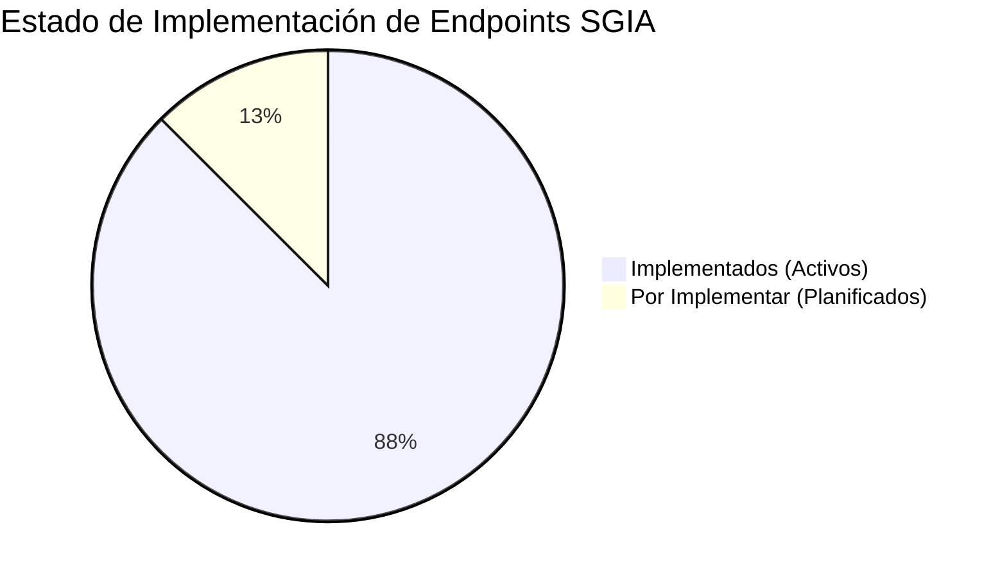

# Catálogo de Endpoints — SGIA Backend API

> Sistema de Gestión de Inventario y Almacenamiento (INACAP Sede Temuco)  
> Base URL local: `http://localhost:8000/api`  
> Formato de datos: `application/json`  
> Mecanismo de autenticación: `Bearer Token` vía Laravel Sanctum en cabecera `Authorization: Bearer <token>`.

---

## Convenciones y Roles de Usuario

| Código | Rol | Descripción |
|---|---|---|
| **AD-01** | Administrador | Acceso total al sistema, gestión de usuarios, auditoría y catálogos. |
| **DIR-01** | Director de Carrera / Asesor | Subida de facturas, cotizaciones, órdenes de compra, reportes y dashboards. |
| **PAN-01** | Pañolero / Encargado | Altas de productos, códigos de barra, préstamos presenciales/remotos y devoluciones. |
| **PRO-01** | Docente / Profesor | Solicitud remota de préstamos de pañol, catálogo y reporte de novedades. |

---

## 🟢 Endpoints Implementados (Listos para Uso)

### 1. Autenticación y Sesiones (`FU-01` / `REQ-01`)

| Método | Endpoint | Roles Permitidos | Descripción / Parámetros | Estado |
|---|---|---|---|:---:|
| `POST` | `/api/login` | Público | Autenticación con email y password. Rate limit: 5 intentos/min. Retorna Bearer token, expiración según dispositivo (`web` 8h, `mobile` 60d) y datos de usuario. <br>**Body:** `email`, `password`, `device_name` (`web` \| `mobile`). | ✅ Implementado |
| `GET` | `/api/me` | Todos (`auth`) | Retorna el recurso del usuario autenticado (`UserResource`) con rol, área, estado y último login. | ✅ Implementado |
| `GET` | `/api/user` | Todos (`auth`) | Alias idéntico de `GET /api/me`. | ✅ Implementado |
| `PUT` | `/api/password` | Todos (`auth`) | Cambio de contraseña del usuario autenticado. Valida contraseña actual, complejidad mínima (8 caracteres, letras y números) y revoca automáticamente las demás sesiones remotas.<br>**Body:** `current_password`, `password`, `password_confirmation`. | ✅ Implementado |
| `POST` | `/api/change-password` | Todos (`auth`) | Alias idéntico de `PUT /api/password`. | ✅ Implementado |
| `POST` | `/api/logout` | Todos (`auth`) | Cierra la sesión activa revocando el Bearer token actual. | ✅ Implementado |
| `POST` | `/api/logout-all` | Todos (`auth`) | Revoca todos los tokens activos del usuario autenticado. | ✅ Implementado |
| `GET` | `/api/tokens` | Todos (`auth`) | Lista todos los tokens y dispositivos activos del usuario autenticado con fecha de creación y expiración. | ✅ Implementado |
| `DELETE` | `/api/tokens/{tokenId}` | Todos (`auth`) | Revoca un token o dispositivo específico por ID. | ✅ Implementado |
| `POST` | `/api/tokens/revoke-others` | Todos (`auth`) | Revoca todas las sesiones excepto la que realiza la petición. | ✅ Implementado |
| `POST` | `/api/tokens/revoke-all` | Todos (`auth`) | Alias de logout global para revocar todas las sesiones. | ✅ Implementado |

---

### 2. Administración de Usuarios (`FU-01` / `REQ-02`)

> Todos los endpoints de este módulo están restringidos estrictamente al rol **AD-01** (Administrador) y protegidos contra auto-eliminación o auto-desactivación del propio administrador.

| Método | Endpoint | Roles Permitidos | Descripción / Parámetros | Estado |
|---|---|---|---|:---:|
| `GET` | `/api/users` | `AD-01` | Listado paginado de usuarios con soporte de búsqueda y filtros.<br>**Query Params:** `role`, `area`, `is_active`, `search` (nombre/email), `per_page` (1-100). | ✅ Implementado |
| `POST` | `/api/users` | `AD-01` | Crea un nuevo usuario en el sistema.<br>**Body:** `name`, `email` (único), `role` (`AD-01`, `DIR-01`, `PAN-01`, `PRO-01`), `area` (opcional), `password`, `password_confirmation`, `is_active` (opcional). | ✅ Implementado |
| `GET` | `/api/users/{id}` | `AD-01` | Obtiene el detalle de un usuario específico. | ✅ Implementado |
| `PUT / PATCH` | `/api/users/{id}` | `AD-01` | Actualiza los datos de un usuario (nombre, rol, área, email con validación de unicidad ignorando propio ID, contraseña opcional). | ✅ Implementado |
| `DELETE` | `/api/users/{id}` | `AD-01` | Elimina un usuario y borra en cascada sus tokens y registros de sesión. | ✅ Implementado |
| `PATCH` | `/api/users/{id}/status` | `AD-01` | Activa o desactiva la cuenta sin borrarla. Si se desactiva (`is_active = false`), se revocan de inmediato todas sus sesiones activas.<br>**Body:** `is_active` (`true` \| `false`). | ✅ Implementado |

---

### 2.1 Ubicaciones Físicas y Cajones (`FU-02` / `REQ-05`)

| Método | Endpoint | Roles Permitidos | Descripción / Parámetros | Estado |
|---|---|---|---|:---:|
| `GET` | `/api/locations` | Todos (`auth`) | Listado paginado de ubicaciones (salas, pañoles, talleres). Soporta filtros por `tipo` (`sala`, `panol`, `taller`, `bodega`) y búsqueda por texto (`search`). Incluye conteo y lista de cajones, más auditoría (`created_by`, `updated_by`). | ✅ Implementado |
| `POST` | `/api/locations` | `AD-01`, `DIR-01`, `PAN-01` | Crea una nueva ubicación física.<br>**Body:** `nombre`, `tipo` (`sala`, `panol`, `taller`, `bodega`), `descripcion`. Registra automáticamente `created_by` y `updated_by`. | ✅ Implementado |
| `GET` | `/api/locations/{id}` | Todos (`auth`) | Detalle de ubicación con todos sus cajones registrados y auditoría. | ✅ Implementado |
| `PUT / PATCH` | `/api/locations/{id}` | `AD-01`, `DIR-01`, `PAN-01` | Actualiza nombre, tipo o descripción de la ubicación. Actualiza `updated_by`. | ✅ Implementado |
| `DELETE` | `/api/locations/{id}` | `AD-01`, `DIR-01` | Elimina una ubicación y sus cajones asociados. | ✅ Implementado |
| `GET` | `/api/cajones` | Todos (`auth`) | Listado de cajones/gavetas/compartimientos. Soporta filtros por `location_id` y búsqueda por código/descripción (`search`). Incluye relación de ubicación y auditoría. | ✅ Implementado |
| `POST` | `/api/cajones` | `AD-01`, `DIR-01`, `PAN-01` | Crea un nuevo cajón dentro de una ubicación.<br>**Body:** `location_id`, `codigo`, `descripcion`. Valida código único por ubicación y registra `created_by` / `updated_by`. | ✅ Implementado |
| `GET` | `/api/cajones/{id}` | Todos (`auth`) | Detalle del cajón con su ubicación padre y total de productos almacenados. | ✅ Implementado |
| `PUT / PATCH` | `/api/cajones/{id}` | `AD-01`, `DIR-01`, `PAN-01` | Actualiza código, descripción o mueve el cajón de ubicación. Actualiza `updated_by`. | ✅ Implementado |
| `DELETE` | `/api/cajones/{id}` | `AD-01`, `DIR-01` | Elimina un cajón. | ✅ Implementado |

---

### 3. Inventario y Productos (`FU-02` / `REQ-03`, `REQ-04`, `REQ-05`)

| Método | Endpoint | Roles Permitidos | Descripción / Parámetros | Estado |
|---|---|---|---|:---:|
| `GET` | `/api/products` | Todos (`auth`) | Listado paginado de productos con relaciones eager loaded (`supplier`, `location`).<br>**Query Params:** `search` (nombre, código de barras o descripción), `area`, `is_active`, `supplier_id`, `location_id`, `sala`, `cajon`, `critical_only`, `per_page`. | ✅ Implementado |
| `POST` | `/api/products` | `AD-01`, `DIR-01`, `PAN-01` | Alta de producto. Si no se envía código de barras, genera automáticamente uno único tipo Code128 (`SGIA-XXXXXXXX`). Si se envían `sala` y `cajon`, crea/asocia la ubicación física automáticamente.<br>**Body:** `name`, `description`, `barcode` (opcional), `quantity`, `stock_minimo`, `supplier_id`, `sala`, `cajon`, `area`, `photo_url`, `is_active`. | ✅ Implementado |
| `GET` | `/api/products/{id}` | Todos (`auth`) | Detalle de un producto con sus relaciones. | ✅ Implementado |
| `PUT / PATCH` | `/api/products/{id}` | `AD-01`, `DIR-01`, `PAN-01` | Edición de producto. Al modificar stock o stock mínimo, evalúa y dispara alertas de stock automáticamente. | ✅ Implementado |
| `DELETE` | `/api/products/{id}` | `AD-01`, `DIR-01` | Eliminación de producto de inventario. | ✅ Implementado |
| `PATCH` | `/api/products/{id}/status` | `AD-01`, `DIR-01`, `PAN-01` | Activa o desactiva un producto del inventario.<br>**Body:** `is_active` (`true` \| `false`). | ✅ Implementado |
| `GET` | `/api/products/{id}/location` | Todos (`auth`) | Obtiene la sala, cajón y descripción de ubicación física de un producto. | ✅ Implementado |
| `PATCH` | `/api/products/{id}/location` | `AD-01`, `DIR-01`, `PAN-01` | Asigna o actualiza la ubicación física.<br>**Body:** `location_id` o combinación de `sala` y `cajon` con `descripcion` opcional. | ✅ Implementado |
| `GET` | `/api/products/{id}/barcode` | Todos (`auth`) | Retorna el código de barras del producto, su representación vectorial en SVG y su formato Data URI / HTML. | ✅ Implementado |

---

### 4. Escaneo de Facturas vía OCR (`FU-02` / `REQ-03`)

| Método | Endpoint | Roles Permitidos | Descripción / Parámetros | Estado |
|---|---|---|---|:---:|
| `POST` | `/api/invoices/scan` | `AD-01`, `DIR-01` | Procesa documento o imagen de factura (PDF, PNG, JPG, JSON de hasta 10MB) y extrae número de factura, proveedor sugerido y lista de borradores de productos con cantidades y precios para su posterior confirmación. | ✅ Implementado |
| `POST` | `/api/products/scan-invoice` | `AD-01`, `DIR-01` | Alias idéntico de `POST /api/invoices/scan`. | ✅ Implementado |

---

### 5. Alertas de Stock Crítico (`FU-02` / `REQ-06`)

| Método | Endpoint | Roles Permitidos | Descripción / Parámetros | Estado |
|---|---|---|---|:---:|
| `GET` | `/api/alerts/critical-stock` | Todos (`auth`) | Listado paginado de alertas activas generadas automáticamente cuando un producto llega a `stock_minimo + 5` (warning) o a `<= stock_minimo` (critical).<br>**Query Params:** `alert_type` (`warning` \| `critical`), `is_resolved` (`false` por defecto), `per_page`. | ✅ Implementado |
| `PATCH` | `/api/alerts/{id}/resolve` | `AD-01`, `PAN-01` | Marca manualmente una alerta de stock como resuelta. | ✅ Implementado |

---

### 6. Compras y Adquisiciones (`FU-03` / `REQ-08`)

> Máquina de estados de las órdenes (`App\Services\PurchaseStateMachine`): **`pendiente` → `en_camino` → `completa`**. Las órdenes pueden generarse a partir de una cotización aceptada de REQ-07 (ver sección 8), en cuyo caso la cotización queda `convertida`.

| Método | Endpoint | Roles Permitidos | Descripción / Parámetros | Estado |
|---|---|---|---|:---:|
| `GET` | `/api/purchases` | `AD-01`, `DIR-01`, `PAN-01` | Listado paginado de órdenes de compra con proveedor e ítems.<br>**Query Params:** `status` (alias `estado`: `pendiente`, `en_camino`, `completa`), `supplier_id`, `quotation_id`, `search` (código, guía o factura), `per_page` (1-100). | ✅ Implementado |
| `POST` | `/api/purchases` | `AD-01`, `DIR-01` | Registra una nueva orden de compra en estado `pendiente`. Genera código único (`OC-<año>-XXXXXX`), persiste los ítems y calcula el total. Si se envía `quotation_id` de una cotización **aceptada**, copia proveedor e ítems de la cotización (a menos que se envíen explícitamente) y la marca como `convertida`.<br>**Body:** `quotation_id` **o** `supplier_id` + `items` (array con `name`, `quantity`, `unit_price` opcional, `product_id` opcional; mínimo 1), `quotation_reference`, `expected_at`, `notes`. | ✅ Implementado |
| `GET` | `/api/purchases/{id}` | `AD-01`, `DIR-01`, `PAN-01` | Detalle de la orden de compra, sus ítems adquiridos, la cotización de origen y las transiciones permitidas (`allowed_transitions`). | ✅ Implementado |
| `PATCH` | `/api/purchases/{id}/status` | `AD-01`, `DIR-01`, `PAN-01` | Transición de estados según la máquina (`pendiente` → `en_camino` → `completa`); una transición inválida responde `422` con los estados permitidos. Al pasar a `completa` registra `received_at` y notifica al pañolero para el ingreso físico a stock.<br>**Body:** `status` (alias `estado`). | ✅ Implementado |
| `POST` | `/api/purchases/{id}/arrival-scan` | `AD-01`, `DIR-01`, `PAN-01` | Marca la orden como `completa` al escanear la guía de despacho / factura de llegada: extrae el número de factura vía OCR, guarda el documento escaneado y notifica al pañolero (PAN-01).<br>**Body (multipart o JSON):** `document` (PDF, PNG, JPG, WEBP o JSON hasta 10MB), `guide_number`, `invoice_number` (al menos uno de los tres). | ✅ Implementado |

---

### 7. Proveedores (`FU-03` / `REQ-07`)

| Método | Endpoint | Roles Permitidos | Descripción / Parámetros | Estado |
|---|---|---|---|:---:|
| `GET` | `/api/suppliers` | `AD-01`, `DIR-01`, `PAN-01` | Listado paginado de empresas proveedoras.<br>**Query Params:** `category`, `is_active`, `search` (nombre, contacto o correo), `per_page` (1-100). Incluye `products_count`. | ✅ Implementado |
| `POST` | `/api/suppliers` | `AD-01`, `DIR-01` | Crear proveedor.<br>**Body:** `name`, `contact_name`, `email`, `phone`, `category`, `is_active`. | ✅ Implementado |
| `GET` | `/api/suppliers/{id}` | `AD-01`, `DIR-01`, `PAN-01` | Detalle del proveedor y su historial de productos suministrados. | ✅ Implementado |
| `PUT / PATCH` | `/api/suppliers/{id}` | `AD-01`, `DIR-01` | Actualizar información del proveedor. | ✅ Implementado |
| `DELETE` | `/api/suppliers/{id}` | `AD-01` | Eliminar proveedor; si tiene productos asociados solo se desactiva, preservando el historial de inventario. | ✅ Implementado |
| `PATCH` | `/api/suppliers/{id}/status` | `AD-01`, `DIR-01` | Activar o suspender proveedor.<br>**Body:** `is_active` (`true` \| `false`). | ✅ Implementado |

---

### 8. Cotizaciones Automáticas (`FU-03` / `REQ-07`)

> Máquina de estados de las cotizaciones (`App\Services\QuotationStateMachine`): **`pendiente` → `aceptada` / `rechazada` → `convertida`** (al generarse la orden de compra, ver sección 6). Además, cada proveedor contactado registra su propia respuesta (`pendiente`, `aceptada`, `rechazada`).

| Método | Endpoint | Roles Permitidos | Descripción / Parámetros | Estado |
|---|---|---|---|:---:|
| `POST` | `/api/quotations` | `AD-01`, `DIR-01` | Crea la cotización, persiste ítems y proveedores contactados y **envía por correo la solicitud a los 3+ proveedores seleccionados** (`App\Services\QuotationEmailService` + `QuotationRequestMail`). Devuelve `emails_sent`.<br>**Body:** `products` (array con `id` y `quantity`, mínimo 1), `supplier_ids` (mínimo 3 proveedores distintos), `notes`, `expires_at`. | ✅ Implementado |
| `GET` | `/api/quotations` | `AD-01`, `DIR-01` | Historial de cotizaciones emitidas con ítems y proveedores contactados.<br>**Query Params:** `status` (alias `estado`: `pendiente`, `aceptada`, `rechazada`, `convertida`), `search` (código), `per_page`. | ✅ Implementado |
| `GET` | `/api/quotations/{id}` | `AD-01`, `DIR-01` | Detalle de la cotización: ítems, proveedores contactados con su respuesta (`status`, `offer_total`, `responded_at`), orden de compra generada y transiciones permitidas. | ✅ Implementado |
| `PATCH` | `/api/quotations/{id}/status` | `AD-01`, `DIR-01` | Transición según la máquina de estados; `422` con los estados permitidos si es inválida.<br>**Body:** `status` (alias `estado`). | ✅ Implementado |
| `PATCH` | `/api/quotations/{id}/responses` | `AD-01`, `DIR-01` | Registra la respuesta de un proveedor contactado. Al registrar una aceptación la cotización pasa a `aceptada`; si todos rechazan, a `rechazada`.<br>**Body:** `supplier_id`, `status` (`aceptada` \| `rechazada`), `offer_total`, `notes`. | ✅ Implementado |

---

### 9. Préstamos Remotos (Pre-reservas Docente) (`FU-04` / `REQ-09`)

> Máquina de estados de los préstamos (`App\Services\LoanStateMachine`): **`pendiente` → `en_proceso` → `procesado`**, con salida a `rechazado` (operaciones del pañol en la sección 10). El docente solo crea y consulta sus propias solicitudes.

| Método | Endpoint | Roles Permitidos | Descripción / Parámetros | Estado |
|---|---|---|---|:---:|
| `POST` | `/api/loans/requests` | `PRO-01` | Solicita préstamo remoto de insumos/equipos para clases. Genera código único (`REM-<año>-XXXXXX`) y responde **"Solicitud enviada correctamente."** junto al registro creado (claves `data` y `loan`) en estado `pendiente`. Valida que cada producto exista, esté activo y tenga stock suficiente.<br>**Body:** `items` (array con `product_id` y `quantity`, mínimo 1), `subject` (alias `asignatura`), `room` (alias `sala`), `loan_date` (alias `fecha`), `time_block` (opcional), `notes` (opcional). | ✅ Implementado |
| `GET` | `/api/loans/requests` | `PRO-01` | Listado paginado de las solicitudes **propias** del docente autenticado.<br>**Query Params:** `estado` (alias `status`: `pendiente`, `en_proceso`, `procesado`, `rechazado`), `per_page` (1-100). | ✅ Implementado |
| `GET` | `/api/loans/my-requests` | `PRO-01` | Alias idéntico de `GET /api/loans/requests` (referencia del catálogo original). | ✅ Implementado |
| `DELETE` | `/api/loans/requests/{id}` | `PRO-01` | Cancelación de solicitud mientras permanezca en estado `pendiente`. | ⏳ Pendiente |

---

### 10. Operación de Préstamos en Pañol (`FU-04` / `REQ-10`)

| Método | Endpoint | Roles Permitidos | Descripción / Parámetros | Estado |
|---|---|---|---|:---:|
| `GET` | `/api/loans/pending` | `PAN-01`, `AD-01` | Solicitudes remotas en estado `pendiente` por despachar; cada ítem devuelve la **cantidad solicitada**, el **stock disponible** (`available_stock`) y la **ubicación física** (`location`: `sala`, `cajon`, `descripcion`).<br>**Query Params:** `per_page` (1-100). | ✅ Implementado |
| `POST` | `/api/loans/{id}/approve` | `PAN-01`, `AD-01` | Aprueba la solicitud: **descuenta el stock** de cada producto (transacción con bloqueo de filas, 422 si no alcanza) y **notifica al solicitante**. Pasa a `en_proceso` y registra `approved_by` / `approved_at`. Evalúa además las alertas de stock (REQ-06). | ✅ Implementado |
| `POST` | `/api/loans/{id}/reject` | `PAN-01`, `AD-01` | Rechaza la solicitud con **motivo obligatorio** y **notifica al solicitante**. No descuenta stock.<br>**Body:** `rejection_reason` (alias `motivo`, mínimo 5 caracteres). | ✅ Implementado |
| `POST` | `/api/loans/checkout` | `PAN-01`, `AD-01` | Registra un **préstamo presencial directo**: crea el préstamo `procesado` con código (`PRE-<año>-XXXXXX`), descuenta stock atómicamente y guarda profesor/estudiante, ítems, asignatura, sala y fecha.<br>**Body:** `borrower_name` (alias `solicitante`), `borrower_document` (alias `credencial`, opcional), `items` (`product_id` + `quantity`, mínimo 1), `subject` (alias `asignatura`), `room` (alias `sala`), `loan_date` (alias `fecha`), `time_block`, `notes` opcionales. | ✅ Implementado |
| `POST` | `/api/loans/{id}/deliver` | `PAN-01`, `AD-01` | Confirma la entrega material al docente (`en_proceso` → `procesado`), registra `processed_by` / `processed_at` y notifica al solicitante. **Nuevo respecto del catálogo original**, necesario para cerrar el ciclo del préstamo remoto. | ✅ Implementado |
| `POST` | `/api/loans/checkin` | `PAN-01` | Devolución de préstamo mediante escaneo de ítems. Reintegra stock o marca ítem en reparación si se reporta daño. | ⏳ Pendiente |

---

### 11. Historial y Auditoría de Préstamos (`FU-04` / `REQ-11`)

> El listado y el detalle devuelven el **campo explícito `status`** junto a los booleanos `is_pending`, `is_in_progress`, `is_processed` y `is_rejected` y el `status_label` correspondiente, para que el cliente aplique su estilo visual y diferencie de un vistazo los préstamos **`procesados`** de los que siguen **`en_proceso`**.

| Método | Endpoint | Roles Permitidos | Descripción / Parámetros | Estado |
|---|---|---|---|:---:|
| `GET` | `/api/loans` | `PAN-01`, `DIR-01`, `AD-01` | Historial de préstamos con ítems (stock disponible y ubicación) y solicitante.<br>**Query Params:** `estado` (alias `status`: `pendiente`, `en_proceso`, `procesado`, `rechazado`), `insumo` (alias `product` o `product_id`: nombre/código del producto en los ítems), `profesor` (alias `teacher` / `borrower`: nombre del docente o de quien retira), `sala` (alias `room`), `tipo` (alias `type`: `remoto` \| `presencial`), `search` (código o asignatura), `per_page` (1-100). `estado` o `tipo` inválidos responden `422`. | ✅ Implementado |
| `GET` | `/api/loans/{id}` | `PAN-01`, `DIR-01`, `AD-01` | Detalle de un préstamo: ítems con producto y ubicación física, solicitante, quién aprobó y quién entregó, motivo de rechazo y `allowed_transitions`. | ✅ Implementado |
| `GET` | `/api/loans/export` | `DIR-01`, `PAN-01`, `AD-01` | Exportación de préstamos en formato PDF o Excel por rango de fechas. | ⏳ Pendiente |

---

## 🟡 Endpoints Pendientes (Por Implementar)

### 12. Fichas Técnicas de Equipos (`FU-05` / `REQ-12`)

| Método | Endpoint Planificado | Roles Previstos | Descripción / Parámetros esperados |
|---|---|---|---|
| `GET` | `/api/equipment/{id}/specs` | Todos (`auth`) | Especificaciones técnicas de equipos, manual de usuario en S3, fecha de compra, vida útil estimada e historial. |
| `PUT` | `/api/equipment/{id}/specs` | `DIR-01`, `AD-01` | Actualizar especificaciones técnicas y enlaces a manuales. |
| `GET` | `/api/equipment/{id}/technical-sheet` | Todos (`auth`) | Genera y descarga la ficha técnica formal en PDF. |
| `GET` | `/api/equipment/{id}/reports` | `DIR-01`, `PAN-01`, `AD-01` | Historial de hojas de vida, mantenciones y novedades del equipo descargables en PDF. |

---

### 13. Informes de Novedades y Fallas (`FU-05` / `REQ-13`)

| Método | Endpoint Planificado | Roles Previstos | Descripción / Parámetros esperados |
|---|---|---|---|
| `POST` | `/api/incident-reports` | `PRO-01`, `PAN-01` | Reporte de equipo dañado o faltante durante clases o devolución.<br>**Body:** `product_id`, `description`, `severity` (`leve`, `media`, `critica`), `photo` (adjunto opcional). Cambia el ítem a `en_revision` o `en_reparacion` y notifica a Pañol y Director. |
| `GET` | `/api/incident-reports` | `DIR-01`, `PAN-01`, `AD-01` | Listado de novedades reportadas con filtros por gravedad y estado de atención. |
| `PATCH` | `/api/incident-reports/{id}/status` | `PAN-01`, `DIR-01` | Actualizar el estado de la incidencia (`en_revision`, `en_reparacion`, `reparado`, `dado_de_baja`). |

---

### 14. Dashboards y Analítica (`FU-06` / `REQ-14`)

| Método | Endpoint Planificado | Roles Previstos | Descripción / Parámetros esperados |
|---|---|---|---|
| `GET` | `/api/dashboard/stats` | `DIR-01`, `AD-01` | Resumen analítico general: total productos por estado (disponible, prestado, reparación, baja), préstamos activos vs atrasados, alertas críticas y tasa de rotación mensual. |
| `GET` | `/api/dashboard/top-products` | `DIR-01`, `AD-01` | Ranking de los 10 productos/equipos con mayor demanda. |
| `GET` | `/api/dashboard/top-supplies` | `DIR-01`, `AD-01` | Ranking de insumos fungibles más solicitados. |
| `GET` | `/api/dashboard/careers-distribution` | `DIR-01`, `AD-01` | Distribución de consumo de insumos y préstamos por carrera/área académica. |
| `GET` | `/api/dashboard/least-demanded` | `DIR-01`, `AD-01` | Equipos con menor rotación o sin uso en el último periodo (inventario ocioso). |
| `GET` | `/api/dashboard/top-teachers` | `DIR-01`, `AD-01` | Docentes con mayor cantidad de solicitudes de préstamos. |
| `GET` | `/api/dashboard/loans-by-teacher` | `DIR-01`, `AD-01` | Préstamos agrupados por docente y asignatura para análisis curricular. |

---

## 💻 Especificación de Campos para Integración Frontend (Web & Móvil)

> Esta sección contiene tablas técnicas detalladas campo por campo de cada endpoint, diseñadas específicamente para que los desarrolladores de Frontend (Web Vue/React y Móvil Flutter) puedan construir formularios, validar datos de entrada, configurar modelos tipados y manejar payloads de solicitud y respuesta sin ambigüedad.

### Módulo 1: Autenticación y Perfil

#### `POST /api/login` (Inicio de Sesión)
- **Content-Type:** `application/json`
- **Autenticación:** Pública (sin token previo).
- **Control de Intentos:** Rate limit de 5 peticiones por minuto.

| Campo | Ubicación | Tipo | Obligatorio | Reglas / Restricciones | Ejemplo |
|---|---|---|:---:|---|---|
| `email` | Body | `string` | **Sí** | Email válido, min: 3, max: 255. | `"director@sgia.cl"` |
| `password` | Body | `string` | **Sí** | Contraseña en texto plano. | `"Sgia2026!"` |
| `device_name` | Body | `string` | No | Nombre del cliente: `"web"` (expira en 8h) o `"mobile"` (expira en 60 días). Default: `"web"`. | `"web"` |

*Respuesta exitosa (`200 OK`):*
```json
{
  "message": "Login exitoso.",
  "token": "1|4y3Gl9ncNsD8MDHNPHBbexz3E6Z9jKF0Y37t9avaba128c16",
  "token_type": "Bearer",
  "user": {
    "id": 2,
    "nombre": "Director de Carrera",
    "name": "Director de Carrera",
    "email": "director@sgia.cl",
    "rol_id": 2,
    "rol": "Director de carrera",
    "role": "DIR-01",
    "panol_id": null,
    "panol": null,
    "activo": true,
    "is_active": true,
    "carreras": [
      { "id": 1, "codigo": "ISD", "nombre": "Ingeniería en Ciberseguridad" }
    ]
  }
}
```

---

#### `PUT /api/password` o `POST /api/change-password` (Cambio de Contraseña)
- **Content-Type:** `application/json`
- **Autenticación:** `Bearer Token` (`AD-01`, `DIR-01`, `PAN-01`, `PRO-01`).

| Campo | Ubicación | Tipo | Obligatorio | Reglas / Restricciones | Ejemplo |
|---|---|---|:---:|---|---|
| `current_password` | Body | `string` | **Sí** | Debe coincidir con la contraseña actual del usuario autenticado. | `"Sgia2026!"` |
| `password` | Body | `string` | **Sí** | Mínimo 8 caracteres, al menos 1 letra y 1 número. Confirmada. | `"NuevaClave2026*"` |
| `password_confirmation` | Body | `string` | **Sí** | Debe ser exactamente igual al campo `password`. | `"NuevaClave2026*"` |

---

#### `DELETE /api/tokens/{tokenId}` (Revocar Sesión Específica)
- **Autenticación:** `Bearer Token`.

| Parámetro | Ubicación | Tipo | Obligatorio | Reglas / Restricciones | Ejemplo |
|---|---|---|:---:|---|---|
| `tokenId` | Path Param | `integer` | **Sí** | ID numérico del token devuelto en `GET /api/tokens`. | `3` |

---

### Módulo 2: Administración de Usuarios (`AD-01`)

#### `GET /api/users` (Listado y Filtros de Usuarios)
- **Content-Type:** N/A (URL Query)
- **Autenticación:** `Bearer Token` (`AD-01`).

| Parámetro | Ubicación | Tipo | Obligatorio | Reglas / Valores Permitidos | Ejemplo |
|---|---|---|:---:|---|---|
| `search` | Query | `string` | No | Busca coincidencia parcial en nombre o email. | `"director"` |
| `role` | Query | `string` | No | Código de rol: `AD-01`, `DIR-01`, `PAN-01`, `PRO-01`. | `"DIR-01"` |
| `rol_id` | Query | `integer` | No | ID del rol: `1`=Admin, `2`=Director, `3`=Pañol, `4`=Ayudante, `5`=Docente. | `2` |
| `panol_id` | Query | `integer` | No | Filtra por pañol asignado (ID existente en `panoles`). | `1` |
| `is_active` | Query | `boolean` | No | `true`, `false`, `1`, `0`. | `true` |
| `per_page` | Query | `integer` | No | Entero entre 1 y 100 (default: 15). | `20` |
| `page` | Query | `integer` | No | Número de página paginada. | `1` |

---

#### `POST /api/users` (Crear Usuario)
- **Content-Type:** `application/json`
- **Autenticación:** `Bearer Token` (`AD-01`).

| Campo | Ubicación | Tipo | Obligatorio | Reglas / Restricciones | Ejemplo |
|---|---|---|:---:|---|---|
| `nombre` *(o `name`)* | Body | `string` | **Sí** | Nombre y apellido, max 150 caracteres. | `"Juan Pérez"` |
| `email` | Body | `string` | **Sí** | Formato email, max 150 caracteres, único en `usuarios`. | `"jperez@sgia.cl"` |
| `rol_id` | Body | `integer` | **Sí (o role)** | ID válido en tabla `roles` (`1` a `5`). | `3` |
| `role` | Body | `string` | **Sí (o rol_id)** | Código de rol (`"AD-01"`, `"DIR-01"`, `"PAN-01"`, `"PRO-01"`). | `"PAN-01"` |
| `panol_id` | Body | `integer` | No | ID de pañol asignado (aplica para Pañoleros / Ayudantes). | `1` |
| `carreras` | Body | `array<int>` | No | Array de IDs de carreras asociadas: `[1, 2]`. | `[1, 2]` |
| `password` | Body | `string` | **Sí** | Mínimo 8 caracteres, alfanumérico, confirmado. | `"Pass2026!"` |
| `password_confirmation` | Body | `string` | **Sí** | Debe coincidir con `password`. | `"Pass2026!"` |
| `activo` *(o `is_active`)*| Body | `boolean` | No | Por defecto `true`. | `true` |

---

#### `PUT / PATCH /api/users/{id}` (Editar Usuario)
- **Content-Type:** `application/json`
- **Autenticación:** `Bearer Token` (`AD-01`).

| Campo | Ubicación | Tipo | Obligatorio | Reglas / Restricciones | Ejemplo |
|---|---|---|:---:|---|---|
| `id` | Path Param | `integer` | **Sí** | ID del usuario a modificar. | `4` |
| `nombre` *(o `name`)* | Body | `string` | No | Max 150 caracteres. | `"Juan Pérez Silva"` |
| `email` | Body | `string` | No | Email válido, único excluyendo el ID actual. | `"jperez_nuevo@sgia.cl"` |
| `rol_id` / `role` | Body | `int/str` | No | ID o código de rol válido. | `4` |
| `panol_id` | Body | `integer` | No | `null` o ID de pañol. | `2` |
| `carreras` | Body | `array<int>` | No | IDs de carreras actualizadas. | `[1]` |
| `password` | Body | `string` | No | Si se envía, debe tener min: 8 y `password_confirmation`. | `"NuevaClave2026!"` |
| `password_confirmation` | Body | `string` | Cond. | Obligatorio si se envía `password`. | `"NuevaClave2026!"` |
| `activo` *(o `is_active`)*| Body | `boolean` | No | Estado de activación. | `true` |

---

#### `PATCH /api/users/{id}/status` (Activar / Desactivar Usuario)
- **Content-Type:** `application/json`
- **Autenticación:** `Bearer Token` (`AD-01`).

| Campo | Ubicación | Tipo | Obligatorio | Reglas / Restricciones | Ejemplo |
|---|---|---|:---:|---|---|
| `id` | Path Param | `integer` | **Sí** | ID del usuario (el admin no puede desactivarse a sí mismo). | `5` |
| `is_active` *(o `activo`)* | Body | `boolean` | **Sí** | `true` para activar, `false` para desactivar y revocar sesiones. | `false` |

---

### Módulo 3: Ubicaciones, Salas y Cajones

#### `POST /api/locations` (Crear Sala / Ubicación)
- **Content-Type:** `application/json`
- **Autenticación:** `Bearer Token` (`AD-01`, `DIR-01`, `PAN-01`).

| Campo | Ubicación | Tipo | Obligatorio | Reglas / Restricciones | Ejemplo |
|---|---|---|:---:|---|---|
| `nombre` | Body | `string` | **Sí** | Nombre de la sala/ubicación, max 100 caracteres. | `"Laboratorio Cisco 3"` |
| `tipo` | Body | `string` | No | `in:sala,panol,taller,bodega` (default: `sala`). | `"sala"` |
| `descripcion` | Body | `string` | No | Notas o referencia física, max 500 caracteres. | `"Edificio C, segundo piso"` |

---

#### `POST /api/cajones` (Crear Cajón / Compartimento)
- **Content-Type:** `application/json`
- **Autenticación:** `Bearer Token` (`AD-01`, `DIR-01`, `PAN-01`).

| Campo | Ubicación | Tipo | Obligatorio | Reglas / Restricciones | Ejemplo |
|---|---|---|:---:|---|---|
| `location_id` | Body | `integer` | **Sí** | ID existente de la sala/ubicación padre. | `2` |
| `codigo` | Body | `string` | **Sí** | Código identificador (único dentro de la sala), max 50. | `"CAJON-A1"` |
| `descripcion` | Body | `string` | No | Detalles del contenedor, max 500 caracteres. | `"Cajonera plástica para componentes SMD"` |

---

### Módulo 4: Catálogo de Inventario, Productos y Equipos

#### `GET /api/products` (Buscar y Filtrar Catálogo)
- **Content-Type:** N/A (URL Query)
- **Autenticación:** `Bearer Token` (Todos los roles).

| Parámetro | Ubicación | Tipo | Obligatorio | Reglas / Filtros disponibles | Ejemplo |
|---|---|---|:---:|---|---|
| `search` | Query | `string` | No | Busca coincidencia en nombre, código de barras o descripción. | `"Osciloscopio"` |
| `carrera` | Query | `string` | No | Código de carrera (`ISD`, `II`, `IC`, `AP`). | `"ISD"` |
| `categoria_id` | Query | `integer` | No | ID existente en `categorias`. | `3` |
| `panol_id` | Query | `integer` | No | ID existente en `panoles`. | `1` |
| `critical_only` | Query | `boolean` | No | `true`: filtra solo productos con stock <= stock mínimo. | `true` |
| `is_active` | Query | `boolean` | No | `true` (activos) o `false` (inactivos). | `true` |
| `per_page` | Query | `integer` | No | 1 a 100 (default: 15). | `25` |

---

#### `POST /api/products` (Creación y Alta de Producto / Insumo)
- **Content-Type:** `application/json`
- **Autenticación:** `Bearer Token` (`AD-01`, `DIR-01`, `PAN-01`).

| Campo | Ubicación | Tipo | Obligatorio | Reglas / Restricciones | Ejemplo |
|---|---|---|:---:|---|---|
| `name` *(o `nombre`)* | Body | `string` | **Sí** | Nombre del producto/equipo, max 255. | `"Tester Digital Truper Mut-39"` |
| `description` | Body | `string` | No | Especificaciones o detalles técnicos. | `"Multímetro digital con auto-rango"` |
| `quantity` *(o `cantidad`)* | Body | `integer` | **Sí** | Unidades iniciales en stock, min: 0. | `10` |
| `stock_minimo` | Body | `integer` | No | Umbral para alerta de stock crítico (default: 5). | `3` |
| `carrera_codigo` | Body | `string` | No | Código de carrera para el barcode (`ISD`, `II`, `IC`, `AP`). | `"ISD"` |
| `barcode` | Body | `string` | No | Código de barras Code128. Si se omite, se autogenera tipo `PREFIJO-CARRERA-CODIGO`. | `"SGIA-ISD-000001"` |
| `categoria_id` | Body | `integer` | No | ID existente en `categorias`. | `2` |
| `panol_id` | Body | `integer` | No | ID existente en `panoles`. | `1` |
| `supplier_id` | Body | `integer` | No | ID de proveedor registrado en `proveedores`. | `1` |
| `estante_id` *(o `cajon_id`)* | Body | `integer` | No | ID del estante o cajón físico de almacenamiento. | `4` |
| `sala` | Body | `string` | No | Nombre de sala referencial si no se envía ID directo. | `"Pañol Central"` |
| `cajon` | Body | `string` | No | Código de cajón referencial. | `"E-02"` |
| `photo_url` | Body | `string` | No | URL de la fotografía del equipo. | `"https://..."` |
| `is_active` | Body | `boolean` | No | Default: `true`. | `true` |

---

#### `PATCH /api/products/{id}/location` (Mover / Reubicar Físicamente)
- **Content-Type:** `application/json`
- **Autenticación:** `Bearer Token` (`AD-01`, `DIR-01`, `PAN-01`).

| Campo | Ubicación | Tipo | Obligatorio | Reglas / Restricciones | Ejemplo |
|---|---|---|:---:|---|---|
| `id` | Path Param | `integer` | **Sí** | ID del producto a mover. | `12` |
| `cajon_id` / `estante_id` | Body | `integer` | Cond. | ID de cajón existente. Obligatorio si no se envían textos. | `5` |
| `sala` | Body | `string` | Cond. | Nombre descriptivo de la sala si no se usa ID. | `"Laboratorio Redes"` |
| `cajon` | Body | `string` | Cond. | Código del cajón si no se usa ID. | `"C-10"` |
| `descripcion` | Body | `string` | No | Nota de reubicación, max 255 caracteres. | `"Movido por mantención de estantes"` |

---

### Módulo 5: Escaneo de Facturas vía OCR

#### `POST /api/invoices/scan` (Procesar Factura / Guía de Despacho)
- **Content-Type:** `multipart/form-data`
- **Autenticación:** `Bearer Token` (`AD-01`, `DIR-01`).

| Campo | Ubicación | Tipo | Obligatorio | Reglas / Formatos aceptados | Ejemplo |
|---|---|---|:---:|---|---|
| `invoice` *(o `document`)*| Form Data | `file` | **Sí** | Archivo `pdf, png, jpg, jpeg, webp` o archivo `.json` de prueba. Máximo 10 MB. | *(archivo binario)* |

*Respuesta exitosa (`200 OK`):*
```json
{
  "message": "Factura procesada exitosamente vía OCR.",
  "invoice_number": "FAC-883491",
  "supplier_detected": "PC Factory S.A.",
  "products": [
    {
      "name": "Cable UTP Cat6 Bobina 305m",
      "quantity": 2,
      "unit_price": 89990,
      "suggested_barcode": "SGIA-IC-000045"
    }
  ]
}
```

---

### Módulo 6: Compras, Órdenes de Compra y Recepción

#### `POST /api/purchases` (Generar Orden de Compra)
- **Content-Type:** `application/json`
- **Autenticación:** `Bearer Token` (`AD-01`, `DIR-01`).

| Campo | Ubicación | Tipo | Obligatorio | Reglas / Restricciones | Ejemplo |
|---|---|---|:---:|---|---|
| `quotation_id` | Body | `integer` | No | ID de cotización previa aprobada. Si se envía, copia los ítems automáticamente. | `4` |
| `supplier_id` | Body | `integer` | Cond. | Obligatorio si no se envía `quotation_id`. ID de proveedor válido. | `2` |
| `expected_at` | Body | `string` | No | Fecha estimada de entrega: `YYYY-MM-DD`. | `"2026-11-15"` |
| `notes` | Body | `string` | No | Observaciones de la orden, max 1000. | `"Despacho directo en Pañol Central"` |
| `items` | Body | `array` | Cond. | Array de ítems (obligatorio si no hay `quotation_id`), min: 1. | `[...]` |
| `items.*.name` | Body | `string` | **Sí** | Nombre del ítem a comprar. | `"Switch Administrable 24p"` |
| `items.*.quantity` | Body | `integer` | **Sí** | Cantidad requerida, min: 1. | `2` |
| `items.*.unit_price` | Body | `number` | No | Precio unitario neto, min: 0. | `145000` |
| `items.*.product_id` | Body | `integer` | No | ID del producto si ya existe en catálogo. | `15` |

---

#### `PATCH /api/purchases/{id}/status` (Cambiar Estado de la Orden)
- **Content-Type:** `application/json`
- **Autenticación:** `Bearer Token` (`AD-01`, `DIR-01`, `PAN-01`).

| Campo | Ubicación | Tipo | Obligatorio | Reglas / Valores válidos | Ejemplo |
|---|---|---|:---:|---|---|
| `id` | Path Param | `integer` | **Sí** | ID de la orden de compra. | `7` |
| `status` *(o `estado`)* | Body | `string` | **Sí** | Transición permitida: `"pendiente"`, `"en_camino"`, `"completa"`. | `"en_camino"` |

---

#### `POST /api/purchases/{id}/arrival-scan` (Recepción Física en Pañol / OCR Guía)
- **Content-Type:** `multipart/form-data` o `application/json`
- **Autenticación:** `Bearer Token` (`AD-01`, `DIR-01`, `PAN-01`).

| Campo | Ubicación | Tipo | Obligatorio | Reglas / Restricciones | Ejemplo |
|---|---|---|:---:|---|---|
| `id` | Path Param | `integer` | **Sí** | ID de la orden a recibir. | `7` |
| `document` | Form Data | `file` | Cond.\* | Guía o factura en PDF/imagen (max 10MB). (\*Obligatorio si no se envían números). | *(archivo)* |
| `guide_number` | Body/Form | `string` | Cond.\* | Número de guía de despacho. | `"GD-44021"` |
| `invoice_number` | Body/Form | `string` | Cond.\* | Número de factura asociada. | `"F-99201"` |

---

### Módulo 7: Proveedores

#### `POST /api/suppliers` (Registrar Proveedor)
- **Content-Type:** `application/json`
- **Autenticación:** `Bearer Token` (`AD-01`, `DIR-01`).

| Campo | Ubicación | Tipo | Obligatorio | Reglas / Restricciones | Ejemplo |
|---|---|---|:---:|---|---|
| `name` | Body | `string` | **Sí** | Razón social del proveedor, max 255. | `"SP Digital Chile SpA"` |
| `contact_name` | Body | `string` | No | Nombre del ejecutivo de ventas, max 255. | `"Carolina Miranda"` |
| `email` | Body | `string` | No | Email de contacto para cotizaciones. | `"ventas@spdigital.cl"` |
| `phone` | Body | `string` | No | Teléfono de contacto, max 50 caracteres. | `"+56912345678"` |
| `category` | Body | `string` | No | Rubro o tipo de insumos, max 100 caracteres. | `"Hardware y Conectividad"` |
| `is_active` | Body | `boolean` | No | Default: `true`. | `true` |

---

### Módulo 8: Cotizaciones Automáticas Licitadas

#### `POST /api/quotations` (Crear Proceso de Cotización — Mínimo 3 Proveedores)
- **Content-Type:** `application/json`
- **Autenticación:** `Bearer Token` (`AD-01`, `DIR-01`).

| Campo | Ubicación | Tipo | Obligatorio | Reglas / Restricciones | Ejemplo |
|---|---|---|:---:|---|---|
| `supplier_ids` | Body | `array<int>` | **Sí** | Array de IDs de proveedores. **Mínimo 3 proveedores distintos** (exigencia reglamentaria). | `[1, 2, 4]` |
| `products` | Body | `array` | **Sí** | Lista de productos solicitados, min: 1 ítem. | `[...]` |
| `products.*.id` | Body | `integer` | **Sí** | ID del producto existente en inventario. | `8` |
| `products.*.quantity` | Body | `integer` | **Sí** | Cantidad a cotizar, min: 1. | `5` |
| `expires_at` | Body | `string` | No | Fecha límite de recepción de ofertas: `YYYY-MM-DD`. | `"2026-11-30"` |
| `notes` | Body | `string` | No | Términos o condiciones especiales de la licitación. | `"Incluir costo de flete a Temuco"` |

---

#### `PATCH /api/quotations/{id}/responses` (Registrar Oferta de un Proveedor)
- **Content-Type:** `application/json`
- **Autenticación:** `Bearer Token` (`AD-01`, `DIR-01`).

| Campo | Ubicación | Tipo | Obligatorio | Reglas / Restricciones | Ejemplo |
|---|---|---|:---:|---|---|
| `id` | Path Param | `integer` | **Sí** | ID de la cotización. | `3` |
| `supplier_id` | Body | `integer` | **Sí** | ID del proveedor (debe pertenecer a los licitados). | `2` |
| `status` | Body | `string` | **Sí** | `"aceptada"` o `"rechazada"`. | `"aceptada"` |
| `offer_total` | Body | `number` | No | Monto total cotizado en pesos chilenos ($), min: 0. | `850000` |
| `notes` | Body | `string` | No | Observaciones sobre tiempos de despacho o garantía. | `"Garantía 12 meses, despacho en 3 días"` |

---

### Módulo 9: Préstamos Remotos (Pre-reservas Móvil / Docente)

#### `POST /api/loans/requests` (Solicitud Docente desde App Móvil)
- **Content-Type:** `application/json`
- **Autenticación:** `Bearer Token` (`PRO-01`).

| Campo | Ubicación | Tipo | Obligatorio | Reglas / Restricciones | Ejemplo |
|---|---|---|:---:|---|---|
| `items` | Body | `array` | **Sí** | Array de equipos/insumos requeridos, min: 1. | `[...]` |
| `items.*.product_id` | Body | `integer` | **Sí** | ID del producto registrado en `productos`. | `5` |
| `items.*.quantity` | Body | `integer` | **Sí** | Cantidad requerida (valida que haya stock disponible). | `2` |
| `subject` *(o `asignatura`)* | Body | `string` | **Sí** | Nombre del ramo o asignatura, max 100 caracteres. | `"Seguridad Ofensiva"` |
| `room` *(o `sala`)* | Body | `string` | **Sí** | Laboratorio o taller donde se utilizarán los equipos. | `"Lab C4"` |
| `loan_date` *(o `fecha`)* | Body | `string` | **Sí** | Fecha prevista para la clase: `YYYY-MM-DD`. | `"2026-10-30"` |
| `time_block` | Body | `string` | No | Horario o bloque pedagógico. | `"08:30 - 10:00"` |
| `notes` | Body | `string` | No | Comentarios o requerimientos específicos de configuración. | `"Equipos deben incluir cables de poder"` |

---

### Módulo 10: Préstamos Presenciales y Operación en Pañol

#### `POST /api/loans/checkout` (Préstamo Presencial en Ventanilla de Pañol)
- **Content-Type:** `application/json`
- **Autenticación:** `Bearer Token` (`PAN-01`, `AD-01`).

| Campo | Ubicación | Tipo | Obligatorio | Reglas / Restricciones | Ejemplo |
|---|---|---|:---:|---|---|
| `borrower_name` | Body | `string` | **Sí** | Nombre del docente o alumno que retira en pañol. | `"Pedro González Morales"` |
| `borrower_document` | Body | `string` | No | RUT o N° de credencial dejado en custodia. | `"18.334.291-K"` |
| `items` | Body | `array` | **Sí** | Array de equipos entregados, min: 1. | `[...]` |
| `items.*.product_id` | Body | `integer` | **Sí** | ID del producto entregado. | `14` |
| `items.*.quantity` | Body | `integer` | **Sí** | Cantidad física despachada. Descuenta stock al instante. | `1` |
| `subject` | Body | `string` | **Sí** | Asignatura de destino. | `"Taller de Hardware"` |
| `room` | Body | `string` | **Sí** | Taller o sala de uso. | `"Taller 1"` |
| `loan_date` | Body | `string` | **Sí** | Fecha del préstamo: `YYYY-MM-DD`. | `"2026-10-26"` |
| `time_block` | Body | `string` | No | Bloque horario. | `"14:30 - 16:00"` |
| `notes` | Body | `string` | No | Observaciones del estado del equipo o accesorios. | `"Con adaptador HDMI incluido"` |

---

#### `POST /api/loans/{id}/reject` (Rechazar Solicitud Remota)
- **Content-Type:** `application/json`
- **Autenticación:** `Bearer Token` (`PAN-01`, `AD-01`).

| Campo | Ubicación | Tipo | Obligatorio | Reglas / Restricciones | Ejemplo |
|---|---|---|:---:|---|---|
| `id` | Path Param | `integer` | **Sí** | ID de la solicitud remota a rechazar. | `18` |
| `rejection_reason` | Body | `string` | **Sí** | Motivo formal del rechazo, min: 5, max 1000 caracteres. | `"Sin disponibilidad por mantención programada."` |

---

### Módulo 11: Novedades, Incidentes y Fallas de Equipos

#### `POST /api/equipment/{product}/reports` (Reportar Falla o Daño de un Equipo)
- **Content-Type:** `multipart/form-data`
- **Autenticación:** `Bearer Token` (`PRO-01`, `PAN-01`).

| Campo | Ubicación | Tipo | Obligatorio | Reglas / Restricciones | Ejemplo |
|---|---|---|:---:|---|---|
| `product` | Path Param | `integer` | **Sí** | ID del producto/equipo averiado. | `7` |
| `description` | Form Data | `string` | **Sí** | Descripción detallada de la anomalía o rotura. | `"La pantalla presenta líneas verticales y no enciende."` |
| `title` | Form Data | `string` | No | Título breve de la novedad, max 255 caracteres. | `"Falla en panel de visualización"` |
| `severity` | Form Data | `string` | No | Nivel de gravedad: `"leve"`, `"media"`, `"critica"` (default: `"media"`). | `"critica"` |
| `attachment` | Form Data | `file` | No | Fotografía o comprobante PDF de la avería (max 10MB). | *(archivo binario)* |

---

### Módulo 12: Métricas y Dashboards Analíticos

#### Endpoints de Consulta (`GET /api/dashboard/*`)
- **Content-Type:** N/A (URL Query)
- **Autenticación:** `Bearer Token` (`DIR-01`, `AD-01`).

| Endpoint | Parámetro | Tipo | Obligatorio | Descripción | Ejemplo |
|---|---|---|:---:|---|---|
| `GET /api/dashboard/top-products` | `limit` | `integer` | No | Cantidad de equipos en el ranking (1 a 50, default: 10). | `limit=5` |
| `GET /api/dashboard/top-products` | `since` | `date` | No | Fecha de inicio del periodo (`YYYY-MM-DD`). | `since=2026-03-01` |
| `GET /api/dashboard/top-supplies` | `limit`, `since` | `int, date` | No | Insumos fungibles con mayor consumo en talleres. | `limit=10` |
| `GET /api/dashboard/careers-distribution`| `since` | `date` | No | Porcentaje y cantidad de uso agrupado por carrera. | `since=2026-01-01` |
| `GET /api/dashboard/least-demanded` | `limit`, `since` | `int, date` | No | Equipos sin movimiento (inventario ocioso). | `limit=15` |
| `GET /api/dashboard/top-teachers` | `limit`, `since` | `int, date` | No | Ranking de docentes por cantidad de préstamos. | `limit=10` |

---

## 📊 Resumen Estadístico de Endpoints



- **Total endpoints implementados:** **49** endpoints principales (56 con alias).
- **Total endpoints planificados:** **7** endpoints.
- **Total proyectado de la API:** **56** endpoints REST.
